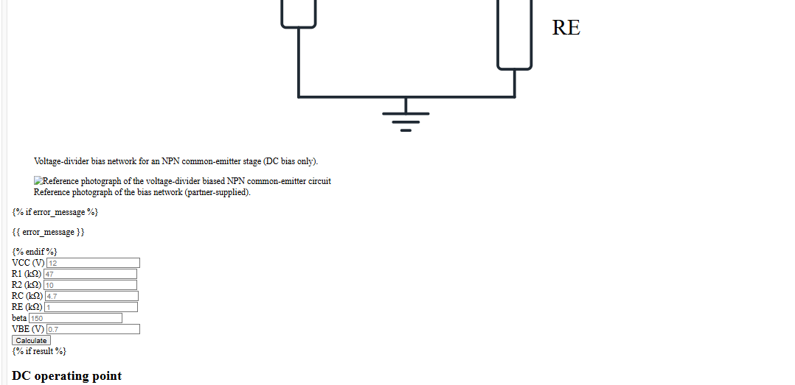

# BJT Common-Emitter DC Bias Web App

A small Flask application for the ENG29 2121 lab. It computes DC operating
points for voltage-divider, fixed-bias and emitter-bias NPN common-emitter
stages, validates the bias values, labels the region, and shows a
beta-independent approximation next to the voltage-divider exact solution as
an independent cross-check. The analytical path is DC only; an optional
ngspice cross-check adds `.op`, `.ac` and `.tran` for the divider stage.

## Circuit



## Requirements

- Python 3.12
- Flask (installed from `requirements.txt`)
- Optional: ngspice 47+ (`ngspice_con`) for the Lab 4 cross-check

## Setup and run

```powershell
python -m venv .venv
.venv\Scripts\python -m pip install -r requirements.txt
.venv\Scripts\python app.py
```

Open <http://127.0.0.1:5000> (or double-click `run.bat`).

## Tests

```powershell
.venv\Scripts\python -m unittest discover -s tests -v
```

The suite covers the hand-worked operating point, cutoff, the cutoff boundary,
near-cutoff behavior, saturation, the approximation, every validation rule,
and the routes.

## Inputs and units

| Input | Unit |
|-------|------|
| Mode | divider, fixed or emitter |
| VCC | V |
| R1, R2 | kΩ (voltage divider only) |
| RB | kΩ (fixed and emitter bias) |
| RC | kΩ |
| RE | kΩ (voltage divider and emitter bias) |
| beta | dimensionless |
| VBE | V |

The engineering module works in SI units (V, Ω, A); the web layer converts
kilohms once. The page shows only the fields required by the selected mode.

## Circuit modes

Choose a circuit with the **Circuit mode** selector on the page, then press
**Load mode** to re-render the form with only that circuit's fields:

| Mode | Fields shown | Equation set |
|------|--------------|--------------|
| Voltage Divider | VCC, R1, R2, RC, RE, beta, VBE | Thevenin divider exact solution, plus cutoff/saturation handling and the beta-independent cross-check |
| Fixed Bias | VCC, RB, RC, beta, VBE | `IB = (VCC − VBE) / RB`, `VE = 0` |
| Emitter Bias | VCC, RB, RC, RE, beta, VBE | `IB = (VCC − VBE) / (RB + (beta + 1) · RE)` |

The mode is carried in a hidden form field, so the calculator never has to
guess which circuit it is computing: `app.py` dispatches with an explicit
`if/elif` on `mode` and answers `400` for any unknown value.

## How RE travels from the form to the module (A4 example)

For the Emitter Bias case with `RE = 2 kΩ` (validation case A4):

1. The browser posts the form; the `re` field arrives as the text `"2"`
   (kilohms) together with the hidden `mode=emitter`.
2. `app.py` → `parse_form(request.form, "emitter")` reads only the fields the
   Emitter Bias mode requires, converts `re` to ohms exactly once
   (`2 → 2000.0`), and raises a field-level `ValidationError` if the value is
   missing or not numeric.
3. `electrical.validate_inputs("emitter", values)` checks the physical rules
   (finite, `VCC > 0`, resistors `> 0`, `beta >= 1`, `0 < VBE < VCC`).
4. `electrical.analyze_emitter_bias(vcc, rb, rc, re, beta, vbe)` receives SI
   units only, computes `IB`, `IC`, `IE`, `VE = IE · RE`, `VB`, `VC`, `VCE`
   and returns one dict shared by all three modes
   (`vbb, rb, vb, ve, vc, ib, ic, ie, vce, region, warning`).
5. The route passes the dict to `templates/index.html`, which only formats
   values through the `V`/`mA`/`µA`/`kΩ` filters — no calculation happens in
   the template.

## Validation record

The A1–A5 browser validation record (Playwright, real form submissions) is in
[`docs/validation.md`](docs/validation.md), with full-page screenshots under
`docs/evidence/`.

## Voltage-divider exact solution

```text
VBB = VCC * R2 / (R1 + R2)
RB  = R1 * R2 / (R1 + R2)
IB  = (VBB - VBE) / (RB + (1 + beta) * RE)
IC  = beta * IB
IE  = (1 + beta) * IB
VE  = IE * RE
VC  = VCC - IC * RC
VB  = VBE + VE
VCE = VC - VE
```

## Fixed-bias solution

```text
IB  = (VCC - VBE) / RB
IC  = beta * IB
IE  = (beta + 1) * IB
VE  = 0
VB  = VE + VBE
VC  = VCC - IC * RC
VCE = VC - VE
```

## Emitter-bias solution

```text
IB  = (VCC - VBE) / (RB + (beta + 1) * RE)
IC  = beta * IB
IE  = (beta + 1) * IB
VE  = IE * RE
VB  = VE + VBE
VC  = VCC - IC * RC
VCE = VC - VE
```

## Independent approximation

```text
VE  ~= VBB - VBE
IE  ~= VE / RE
IC  ~= IE
VCE ~= VCC - IC * (RC + RE)
```

The page shows `beta * RE / RB`; the approximation is labeled valid when the
ratio is at least 10, and the percent difference in `IC` is shown alongside.

## Region rules

- **Voltage divider:** cutoff when `VBB <= VBE` (`IB = IC = IE = 0`,
  `VCE = VCC`); saturation when the active solution gives `VCE < 0.2 V`, in
  which case the page warns and shows a saturation estimate with `VCE` pinned
  at `0.2 V` using `IE = IC + IB`. Otherwise the transistor is **active**.
- **Fixed and emitter bias:** the forward-active equations are always shown.
  If `IB <= 0 A` or `VCE <= 0.2 V`, the page labels the region accordingly and
  warns that the forward-active model may not be valid.

## Worked example

`VCC = 12 V`, `R1 = 47 kΩ`, `R2 = 10 kΩ`, `RC = 4.7 kΩ`, `RE = 1 kΩ`,
`beta = 150`, `VBE = 0.7 V`:

- exact: `IC ≈ 1.324 mA`, `VCE ≈ 4.446 V`, active
- approximation: `IC ≈ 1.405 mA`, `VCE = 3.99 V`, about `6.2%` difference

## ngspice cross-check (Lab 4)

Tick **Also run ngspice** on the Voltage Divider form to simulate the same
stage and compare it with the analytical solution.

Requirements: `ngspice_con` 47 or newer. Verified with `ngspice-47_64.7z`
installed at `C:\Spice64` with `C:\Spice64\bin` on the user PATH. If ngspice is
missing, the page still shows the analytical result and prints an install hint
instead of failing.

| Analysis | Setup | Reported |
|----------|-------|----------|
| `.op` | The divider stage with the entered values | VB, VE, VC, IC, VCE beside the analytical values, with percent difference |
| `.ac` | 1 V AC probe through a 10 µF coupling capacitor, 10 Hz–1 MHz | Gain at 1 kHz, lower and upper −3 dB corners |
| `.tran` | 10 mV, 1 kHz sine, 3 ms | Output swing, transient gain, clipping flag |

The model card is `NPN(IS=1e-14 BF=beta VAF=100 CJC=3p CJE=10p TF=0.3n)`, so
`beta` is honoured but the base-emitter voltage is solved by the model rather
than fixed at the entered VBE. That is why the comparison shows a few percent
difference: for the worked example the analytical solution assumes
`VBE = 0.70 V` while ngspice settles at `VBE ≈ 0.662 V`, giving `IC` 1.324 vs
1.363 mA and `VCE` 4.446 vs 4.228 V. This is expected and is stated on the page.

## Scope

The analytical calculators are DC bias only. The optional ngspice cross-check
(Lab 4) adds `.op`, `.ac` and `.tran` for the voltage-divider stage and never
changes the analytical result. No schematic editor or FET support.

## Project layout

```text
app.py                  Flask routes, mode dispatch, form parsing and filters
electrical.py           fixed-bias, emitter-bias and voltage-divider calculations
engineering/bjt.py      voltage-divider approximation and legacy exact module
engineering/ngspice.py  optional .op/.ac/.tran cross-check via ngspice_con
templates/index.html    single-page form and results
static/style.css        stylesheet
tests/                  engineering, route and simulator tests
docs/validation.md      A1-A5 browser validation record
docs/evidence/          full-page screenshots for each validation case
docs/images/            circuit image used by this README
```

---

# Smart Plant Watering System

วัตถุประสงค์และคำอธิบาย: ระบบรดน้ำต้นไม้อัตโนมัติที่ใช้เซนเซอร์วัดความชื้นในดินร่วมกับบอร์ดไมโครคอนโทรลเลอร์ เพื่อตรวจสอบความชื้นและสั่งการปั๊มน้ำโดยอัตโนมัติ ช่วยให้ต้นไม้ได้รับน้ำในปริมาณที่เหมาะสมและลดภาระในการดูแลรักษา
