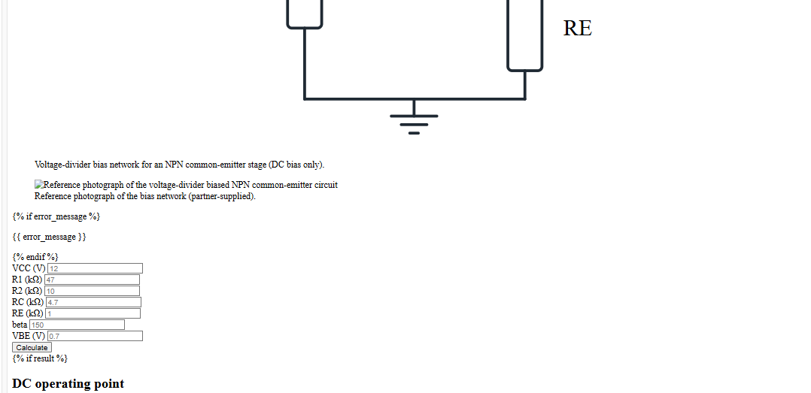

# BJT Common-Emitter DC Bias Web App

A small Flask application for the ENG29 2121 lab. It computes the DC operating
point of a voltage-divider-biased common-emitter BJT stage, validates the bias
values, labels the region, and shows a beta-independent approximation next to
the exact solution as an independent cross-check. The analysis is DC only.

## Circuit



## Requirements

- Python 3.12
- Flask (installed from `requirements.txt`)

## Setup and run

```powershell
python -m venv .venv
.venv\Scripts\python -m pip install -r requirements.txt
.venv\Scripts\python app.py
```

Open <http://127.0.0.1:5000> (or double-click `run.bat`).

## Tests

```powershell
.venv\Scripts\python -m unittest discover -s tests -v
```

The suite covers the hand-worked operating point, cutoff, the cutoff boundary,
near-cutoff behavior, saturation, the approximation, every validation rule,
and the routes.

## Inputs and units

| Input | Unit |
|-------|------|
| VCC | V |
| R1, R2, RC, RE | kΩ |
| beta | dimensionless |
| VBE | V |

The engineering module works in SI units (V, Ω, A); the web layer converts
kilohms once.

## Exact solution

```text
VBB = VCC * R2 / (R1 + R2)
RB  = R1 * R2 / (R1 + R2)
IB  = (VBB - VBE) / (RB + (1 + beta) * RE)
IC  = beta * IB
IE  = (1 + beta) * IB
VE  = IE * RE
VC  = VCC - IC * RC
VB  = VBE + VE
VCE = VC - VE
```

## Independent approximation

```text
VE  ~= VBB - VBE
IE  ~= VE / RE
IC  ~= IE
VCE ~= VCC - IC * (RC + RE)
```

The page shows `beta * RE / RB`; the approximation is labeled valid when the
ratio is at least 10, and the percent difference in `IC` is shown alongside.

## Region rules

- **Cutoff** when `VBB <= VBE`: `IB = IC = IE = 0`, `VCE = VCC`.
- **Saturation** when the active solution gives `VCE < 0.2 V`: the page warns
  and shows a saturation estimate with `VCE` pinned at `0.2 V`, using the base
  and collector loops with `IE = IC + IB`.
- Otherwise the transistor is **active**.

## Worked example

`VCC = 12 V`, `R1 = 47 kΩ`, `R2 = 10 kΩ`, `RC = 4.7 kΩ`, `RE = 1 kΩ`,
`beta = 150`, `VBE = 0.7 V`:

- exact: `IC ≈ 1.324 mA`, `VCE ≈ 4.446 V`, active
- approximation: `IC ≈ 1.405 mA`, `VCE = 3.99 V`, about `6.2%` difference

## Scope

DC bias only. No AC analysis, transient analysis, schematic editor or FET
support.

## Project layout

```text
app.py                  Flask routes, form parsing and template filters
engineering/bjt.py      exact and approximate engineering calculations
templates/index.html    single-page form and results
static/style.css        stylesheet
tests/                  engineering and route tests
docs/images/            circuit image used by this README
```

---

# Smart Plant Watering System

วัตถุประสงค์และคำอธิบาย: ระบบรดน้ำต้นไม้อัตโนมัติที่ใช้เซนเซอร์วัดความชื้นในดินร่วมกับบอร์ดไมโครคอนโทรลเลอร์ เพื่อตรวจสอบความชื้นและสั่งการปั๊มน้ำโดยอัตโนมัติ ช่วยให้ต้นไม้ได้รับน้ำในปริมาณที่เหมาะสมและลดภาระในการดูแลรักษา
