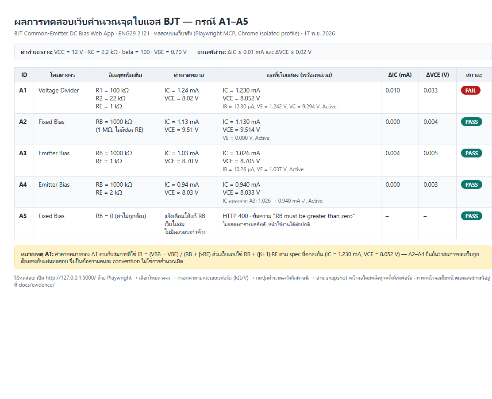
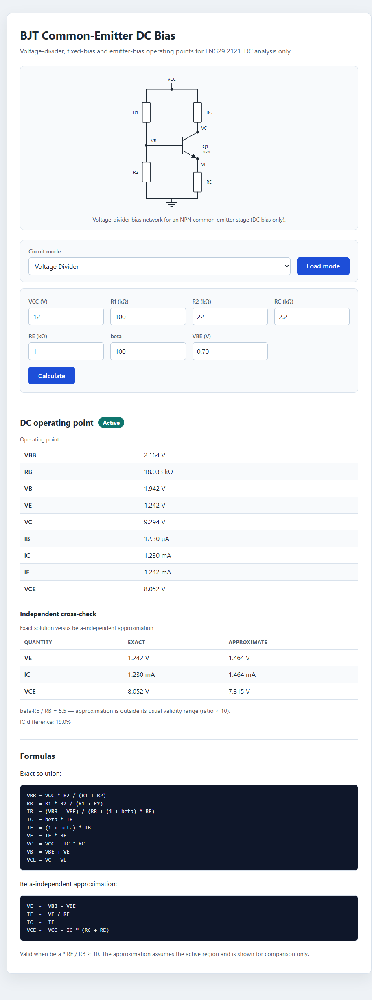
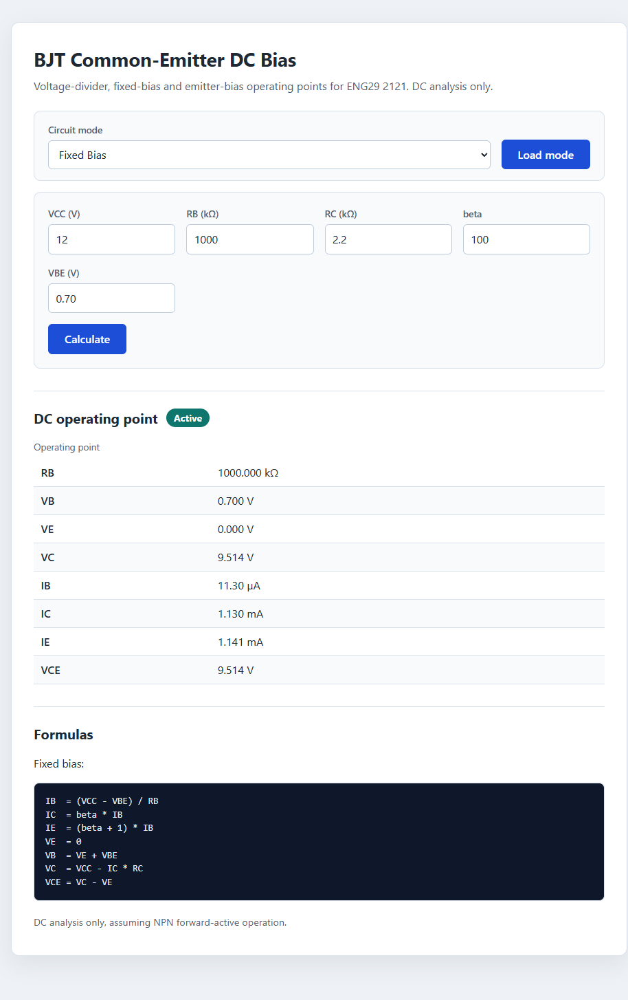
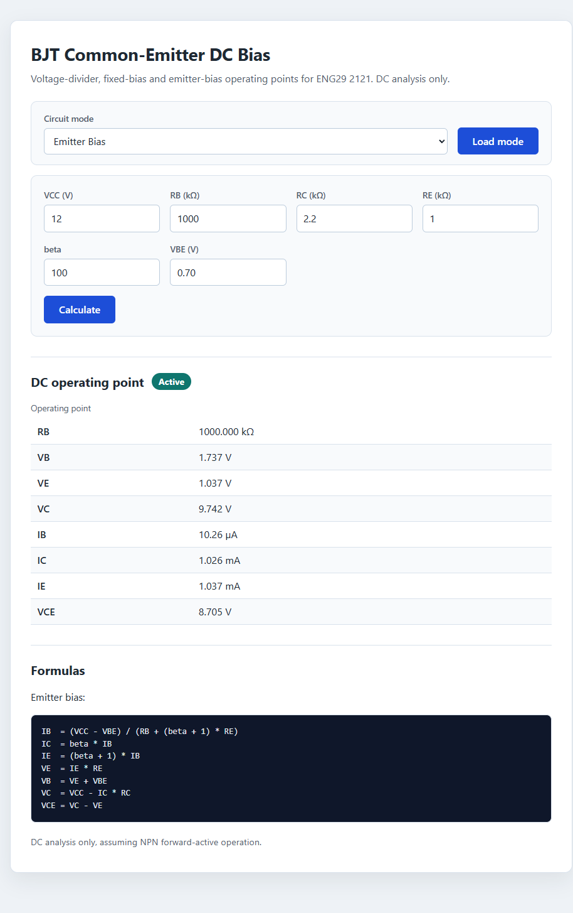
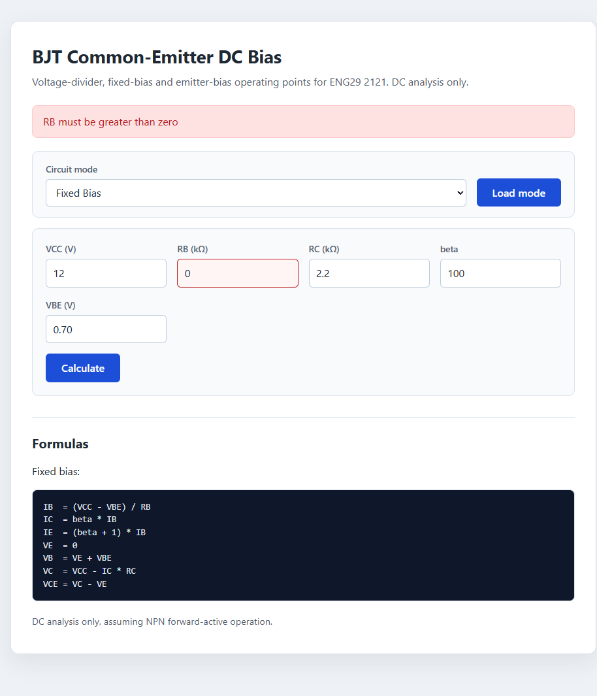

# Validation record — BJT bias modes (A1–A5)

Date: 2026-11-17
Target: <http://127.0.0.1:5000/>
Method: real browser session via Playwright MCP (Chrome, isolated profile).
Every mode change and every submission was followed by a fresh page snapshot;
no result was carried over between cases.

Summary table (for quick sharing):

## Global inputs and tolerance

All cases use:

| Input | Value |
|-------|-------|
| VCC | 12 V |
| RC | 2.2 kΩ |
| beta | 100 |
| VBE | 0.70 V |

Tolerance: `IC` difference ≤ 0.01 mA and `VCE` difference ≤ 0.02 V.

## Results

| ID | Mode | Inputs (on top of the global values) | Expected | Observed (with units) | Status | Evidence |
|----|------|--------------------------------------|----------|------------------------|--------|----------|
| A1 | Voltage Divider | R1 = 100 kΩ, R2 = 22 kΩ, RE = 1 kΩ | IC = 1.24 mA, VCE = 8.02 V | IC = 1.230 mA, VCE = 8.052 V (IB = 12.30 µA, VE = 1.242 V, VC = 9.294 V, region Active) | FAIL |  |
| A2 | Fixed Bias | RB = 1000 kΩ (1 MΩ) | IC = 1.13 mA, VCE = 9.51 V | IC = 1.130 mA, VCE = 9.514 V, VE = 0.000 V, region Active | PASS |  |
| A3 | Emitter Bias | RB = 1000 kΩ, RE = 1 kΩ | IC = 1.03 mA, VCE = 8.70 V | IC = 1.026 mA, VCE = 8.705 V, region Active | PASS |  |
| A4 | Emitter Bias | RB = 1000 kΩ, RE = 2 kΩ | IC ≈ 0.94 mA, VCE ≈ 8.03 V | IC = 0.940 mA, VCE = 8.033 V, region Active | PASS |  |
| A5 | Fixed Bias | RB = 0 (invalid) | Error message about RB, page must not crash, no stale result | HTTP 400 with `RB must be greater than zero`, no results section rendered | PASS |  |

## Deltas against expected values

| ID | ΔIC (mA) | ΔVCE (V) | Tolerance check |
|----|----------|----------|-----------------|
| A1 | 0.010 | 0.033 | VCE exceeds 0.02 V → FAIL |
| A2 | 0.000 | 0.004 | within tolerance |
| A3 | 0.004 | 0.005 | within tolerance |
| A4 | 0.000 | 0.003 | within tolerance |
| A5 | n/a | n/a | validation behavior as required |

## A1 root cause

The expected values for A1 match the variant
`IB = (VBB − VBE) / (RB + beta * RE)` exactly:

| Equation variant | IB | IC | VCE |
|------------------|----|----|-----|
| Test sheet (`RB + beta * RE`) | 12.40 µA | 1.240 mA | 8.019 V ≈ expected 1.24 / 8.02 |
| App (`RB + (beta + 1) * RE`, per the approved spec) | 12.30 µA | 1.230 mA | 8.052 V |

A2–A4 agree with the app's equations, so the app's math is consistent; the A1
expected values were produced with a different convention. Either the sheet
should be updated to `IC ≈ 1.23 mA, VCE ≈ 8.05 V`, or the spec's `(beta + 1)`
convention should be revisited (changing it would also change A3/A4, which use
`(beta + 1)` on the sheet and currently pass).

## A5 behavior

- The server answered `400 BAD REQUEST` (intentional validation failure).
- The page rendered the alert `RB must be greater than zero` and kept the
  entered values, but did not render the operating-point section, so no stale
  result from a previous run remained.
- The process did not crash; subsequent requests still worked.

## Console notes

Two browser console errors were observed during the session:

- `favicon.ico` returns 404 — cosmetic, unrelated to the calculations.
- `400 (BAD REQUEST)` on the A5 submission — the intended validation response.
