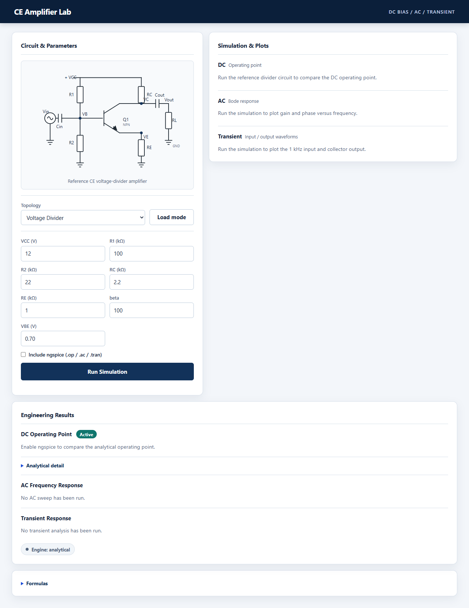
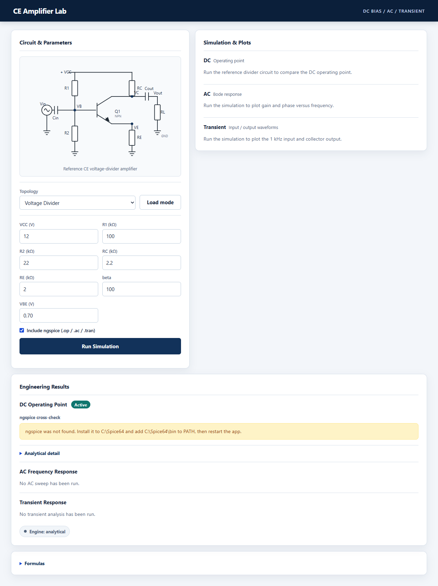
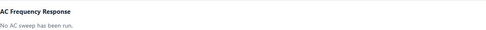
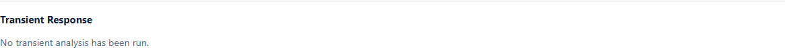

# BJT CE Simulator — B1–B5 browser validation

Date: 2026-11-25  
Target: <http://127.0.0.1:5000>  
Method: Python Playwright (Chrome), viewport 1280×900, real form submissions.

## Fixture

VCC 12 V, beta 100, VBE 0.70 V. CE reference: R1 100 kΩ, R2 22 kΩ, RC 2.2 kΩ, RE 1 kΩ.
B3 changes only RE: 1 kΩ → 2 kΩ. Source fixture (10 mV peak, 1 kHz) is not exposed by this app.

## Comparison table

| Case | Analytical (browser) | Real ngspice | Status |
|------|----------------------|--------------|--------|
| B1 | Fixed: IB 11.30 µA, IC 1.130 mA, VCE 9.514 V (PASS). Emitter: IB 10.26 µA, IC 1.026 mA, VCE 8.705 V (PASS). Divider: IB 12.30 µA, IC 1.230 mA, VCE 8.052 V vs Lab 3 sheet IC 1.24 mA / VCE 8.02 V (FAIL). | not used | FAIL (divider only) |
| B2 | IB 12.30 µA, IC 1.230 mA, VCE 8.052 V, VB 1.942 V, VE 1.242 V, VC 9.294 V | none — ngspice was not found | NOT RUN |
| B3 | IB 12.30 µA → 6.65 µA, IC 1.230 mA → 0.665 mA, VCE 8.052 V → 9.192 V; operating point changed, no stale result | none — no .op output | PASS (analytical freshness) / NOT RUN (SPICE) |
| B4 | Av / fL / fH not produced; no AC sweep | none — no .ac output | NOT RUN |
| B5 | Vout peak-to-peak not produced; no transient analysis | none — no .tran output | NOT RUN |

No ngspice version or BJT model was exercised. The page reported: `ngspice was not found. Install it to C:\Spice64 and add C:\Spice64\bin to PATH, then restart the app.`
No Av, fL, fH, Vout peak-to-peak, Bode data, or waveform data was fabricated.

## Evidence

